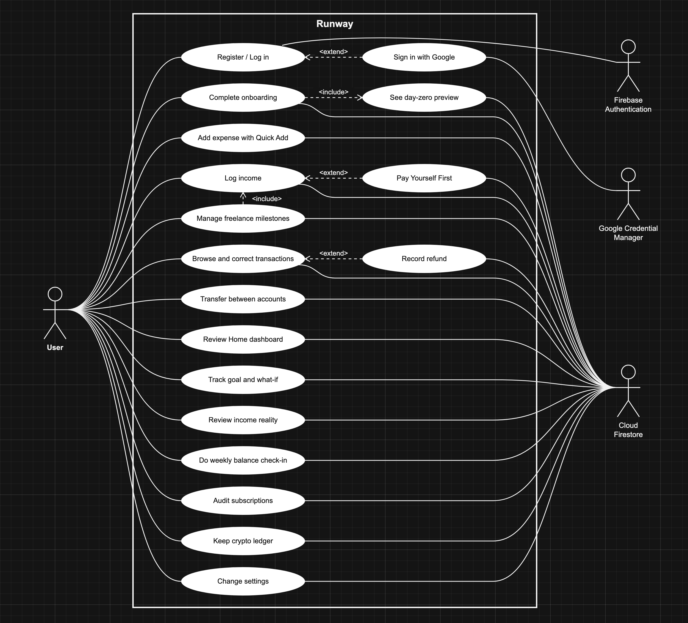
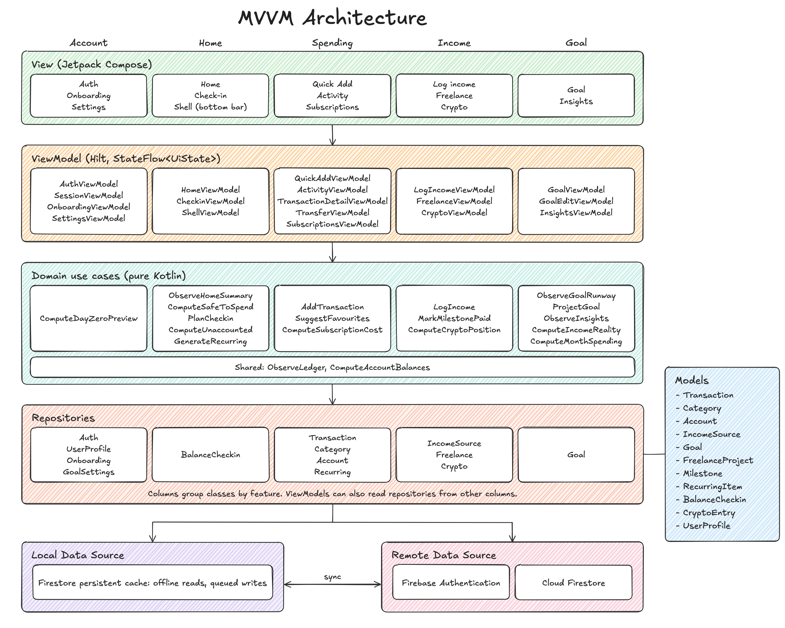
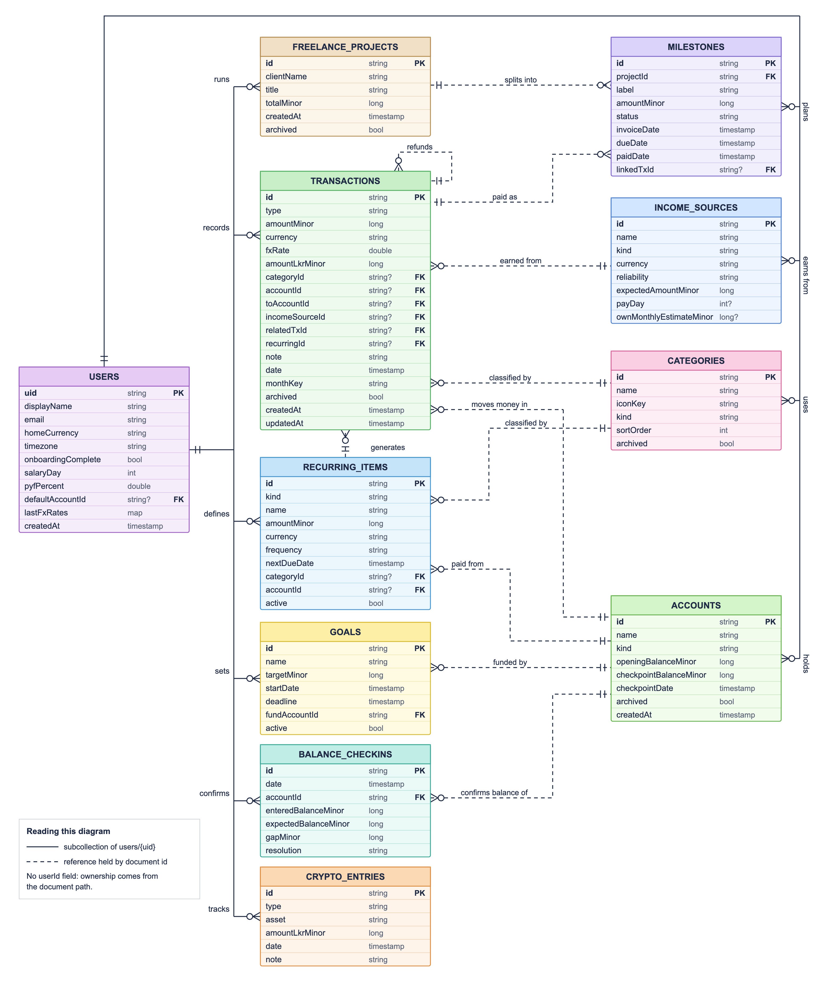

# Runway

Android personal finance app for SE3092 Platform Based Development, Assignment 01.

## Overview

Runway is built for Kavindu Silva's scenario: irregular income from four sources, one in USD, and a LKR 490,000 MacBook goal.

- **Quick Add:** log an expense in 3 taps, with Undo.
- **Income:** logged per source. USD entries keep their own exchange rate.
- **Safe to Spend:** a daily figure based on base salary only.
- **Goal:** required monthly saving, actual pace, projected date and a what-if for purchases.
- **Weekly check-in:** enter real balances so totals stay true after missed days.
- **Also:** committed versus discretionary split, freelance milestones with overdue alerts, subscription audit, crypto ledger.



## Firebase setup

The app uses the live project `runway-a1a74`. `app/google-services.json` is committed, so a clone runs with no setup.

To use your own project:

1. Create a Firebase project and add an Android app with package `com.example.runway`.
2. Add your debug SHA-1 (`./gradlew signingReport`). Google Sign-In needs it.
3. Replace `app/google-services.json` with yours.
4. Enable Email/Password and Google under Authentication.
5. Create a Firestore database.
6. Deploy the rules and indexes:

   ```bash
   firebase deploy --only firestore:rules,firestore:indexes
   ```

## Build

**Android Studio (any system):** open the project folder, let Gradle sync, and run the `app` configuration. Android Studio brings its own JDK and installs any missing SDK components.

**Terminal:** needs JDK 17 or newer, and the Android SDK location in the `ANDROID_HOME` environment variable.

macOS and Linux:

```bash
./gradlew assembleDebug
```

Windows:

```bat
gradlew.bat assembleDebug
```

The APK is at `app/build/outputs/apk/debug/app-debug.apk`. Min SDK 26, target SDK 36.

Unit tests use the same wrapper with `testDebugUnitTest` in place of `assembleDebug`.

## Architecture

MVVM, single activity, Kotlin and Jetpack Compose only.



- **Screens** (`ui/feature`) render state and send events. They never touch Firebase.
- **ViewModels** come from Hilt and expose read-only `StateFlow`.
- **Use cases** (`domain/usecase`) hold the formulas in pure Kotlin.
- **Repositories** are interfaces in `domain`, implemented in `data` with Firestore snapshot listeners.
- **Offline** uses the Firestore persistent cache, so there is no Room database.
- **Data** lives under `users/{uid}`, and `firestore.rules` limits access to the owner.

### Firestore schema


